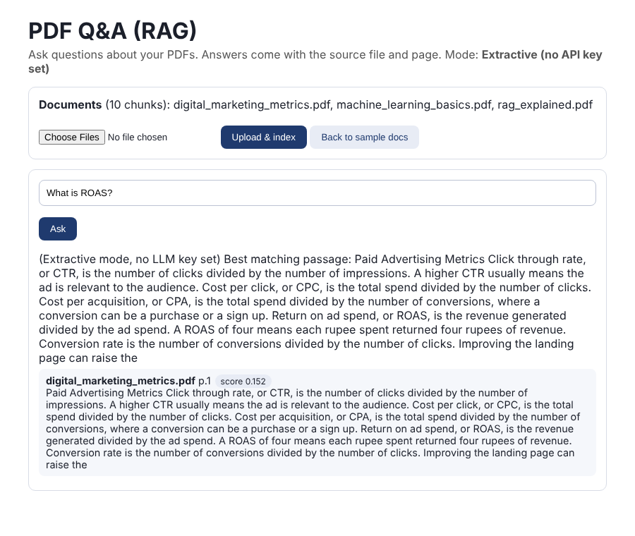

# PDF Q&A with Retrieval-Augmented Generation (RAG)

Ask questions about your own PDFs and get answers with the **source file and page number**.
Built with Python, pypdf and Flask (pure-Python TF-IDF, no heavy ML libraries needed). Works offline out of the box and
optionally uses the Gemini API to write grounded answers.



## How it works
1. **Load** PDFs page by page (`rag/loader.py`).
2. **Chunk** each page into ~120-word pieces with 30-word overlap, keeping the page number.
3. **Index** chunks with TF-IDF (default, offline) or sentence-transformer embeddings (optional).
4. **Retrieve** the top-k chunks most similar to the question (`rag/retriever.py`).
5. **Generate**: with `GEMINI_API_KEY` set, the chunks are sent to Gemini with an instruction to answer only
   from them and cite sources; without a key the app shows the best matching passage (`rag/llm.py`).
6. If nothing relevant is found it says so instead of guessing.

## Run it
```bash
pip install -r requirements.txt
python app.py            # open http://127.0.0.1:5000
```
Sample PDFs are in `sample_docs/`. Upload your own in the browser (they replace the samples).

Optional settings:
```bash
export GEMINI_API_KEY=your_key        # enables LLM answers (get a key from Google AI Studio)
export GEMINI_MODEL=gemini-2.0-flash  # change if the model name has been retired
pip install sentence-transformers && export RAG_BACKEND=embed   # semantic search
```

## Evaluate
```bash
python eval.py            # hit@3 on eval_questions.json
python -m unittest discover -s tests -t .
```
`eval.py` checks whether the correct file and an expected keyword appear in the top-3 retrieved chunks.
The bundled questions are an easy smoke test on tiny sample documents. **For a real result, put your own
PDFs in `sample_docs/`, write 20+ harder questions (paraphrased, not copied from the text) in
`eval_questions.json`, and report that number.**

## Limitations
- TF-IDF matches words, not meaning; paraphrased questions can miss (use `RAG_BACKEND=embed`).
- Scanned PDFs without a text layer are not supported (no OCR).
- The index is in memory and rebuilt on upload; fine for dozens of PDFs, not thousands.

## Project layout
```
app.py            Flask web app
rag/              loader, retriever, llm, pipeline
eval.py           retrieval evaluation
tests/            unit + endpoint tests
sample_docs/      3 sample PDFs (regenerate with make_sample_docs.py)
```
